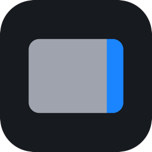
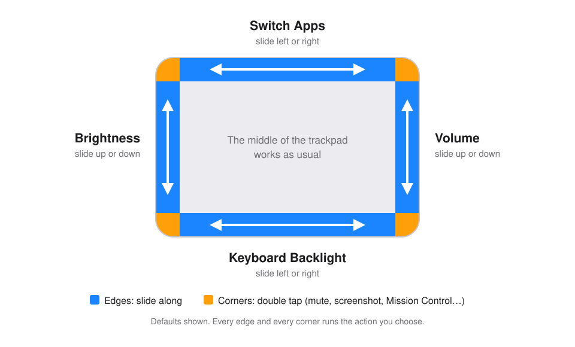

<div align="center">



# trrek

**Your trackpad's edges, turned into controls.**

Slide a finger along an edge to change the volume, the brightness or the keyboard backlight, switch apps, tabs or desktops, scrub a video or zoom. Double tap a corner to mute, take a screenshot or open Mission Control.

[](https://github.com/burakseyitkara1/trrek/releases/latest)
[](https://github.com/burakseyitkara1/trrek/actions/workflows/ci.yml)
[](#requirements)
[](#requirements)
[](LICENSE)

### [⬇ Download the latest version](https://github.com/burakseyitkara1/trrek/releases/latest)

Signed with Developer ID and notarized by Apple · Free and open source

Requires macOS 26 or later on a Mac with Apple silicon

[See trrek in motion on the website](https://burakseyitkara1.github.io/trrek/)

</div>

<br>

<p align="center">
  <picture>
    <source media="(prefers-color-scheme: dark)" srcset="docs/images/trackpad-dark.svg">
    
  </picture>
</p>

## Why trrek

- **Controls where your finger already is.** No reaching for function keys, no hunting for a menu bar slider. The middle of the trackpad keeps working exactly as before.
- **Every edge and corner is yours.** Pick from eleven slide actions and nine corner actions, per edge and per corner.
- **Feels native.** Haptic clicks for every step, the system's own volume and brightness indicators, a Liquid Glass settings window, English and Turkish.
- **Light.** Sits in the menu bar at 0% CPU when idle and about 13 MB of memory. No timers, no background polling.
- **Keeps itself up to date.** A small arrow on the menu bar icon tells you a new version is out; one click downloads, verifies and installs it.

## Features

### Edges: slide along

Forward is to the right on the top and bottom edges and up on the side edges.

| Action | What a slide does |
| --- | --- |
| **Volume** | Turns the volume up or down, with the system indicator |
| **Brightness** | Changes the brightness of the screen with the pointer, including external displays that support DDC/CI |
| **Keyboard Backlight** | Sets the keyboard backlight, with a level overlay |
| **Switch Apps** | Opens the app switcher and moves through your apps; lift to switch |
| **Switch Tabs** | Next or previous tab in the front app (⌃⇥ / ⌃⇧⇥) |
| **Switch Desktops** | Next or previous desktop (⌃→ / ⌃←) |
| **Scrub Video** | Skips forward or back in most video players and browsers (← / →) |
| **Media** | Next or previous track; a double tap plays or pauses |
| **Zoom** | Zooms the front app in or out (⌘= / ⌘−) |
| **Undo & Redo** | Steps back or forward through the front app's history (⌘Z / ⇧⌘Z) |
| **Off** | Leaves the edge alone |

By default the right edge is Volume, the left edge Brightness, the top edge Switch Apps and the bottom edge Keyboard Backlight.

### Corners: double tap

| Action | What a double tap does |
| --- | --- |
| **Mute** | Mutes or unmutes the sound |
| **Screenshot** / **Screenshot Area** | Captures the screen, or a selection |
| **Play/Pause** | Plays or pauses media |
| **Mission Control** / **App Windows** / **Show Desktop** | Opens Mission Control in that mode, whatever its keyboard shortcuts are |
| **Spotlight** | Opens Spotlight |
| **Lock Screen** | Locks the Mac |

### And also

- **Slide Sensitivity** from Very Low to Very High, and **Precision Control** for quarter steps
- **Freeze Cursor**: the pointer stays still and scrolling pauses while you slide
- **Three-finger tap** for a middle click
- **Hold-to-Slide key**: only slide while a modifier is held, or toggle edges on and off with it
- **Edges per app**: give an app its own edge actions, such as Switch Tabs on the top edge in a browser or Scrub Video in a video player
- **Pause in apps** where you don't want trrek, such as games or drawing apps
- Palms and typing never trigger a slide
- **Export and import settings** as a `.trrek` file to move them to another Mac
- **Launch at login**, English and Turkish interface

## Install

1. [Download the DMG](https://github.com/burakseyitkara1/trrek/releases/latest), open it and drag **trrek** onto **Applications**.
2. Open trrek. It lives in the menu bar; there is no Dock icon.
3. When asked, allow trrek in **System Settings › Privacy & Security › Accessibility**.

That's it. Put a finger on the right edge of the trackpad and slide up.

<a name="requirements"></a>**Requirements:** macOS 26 or later on a Mac with Apple silicon and a trackpad (built-in or external).

> [!NOTE]
> Without the Accessibility permission only the keyboard backlight edge works: macOS does not deliver the key and media events trrek sends for everything else. Until it is granted, trrek shows a dot on its menu bar icon and its welcome window at each launch.

## Using trrek

- **Slide** along an edge strip; each step gives a light haptic click.
- **A second finger** cancels a slide; **lifting** commits it (Switch Apps switches when you lift).
- **Double tap** a corner for its action. A corner keeps working when an edge next to it is Off.
- **Edges per app:** choose an app under **Edges For** in the Edges tab (or **Add App…**) and click the edges it should change on the diagram; the others stay **Same as All Apps**. They apply while that app is in front, also while a trrek window is open over it, and the menu shows **Edges set for** the app. A paused app stays paused.

Open **Settings** from the menu bar icon, or by opening trrek again while it runs:

| Tab | What you set |
| --- | --- |
| **General** | Haptics, Slide Sensitivity, Precision Control, Freeze Cursor, launch at login, language, updates, export and import, reset |
| **Edges** | The action of each edge (click it on the trackpad diagram), for all apps or for one app, edge width and Bottom Quarter Only (the diagram draws the touch zones to scale with your trackpad), External Monitor Brightness |
| **Corners & Taps** | The action of each corner (click its badge on the trackpad diagram), three-finger middle click |
| **Advanced** | Hold-to-Slide key and mode, paused apps, Accessibility status |

## Updates and privacy

trrek checks this repository's releases at most once a day. When a new version is out, the menu bar icon shows a small arrow and the menu offers **Update Available**. Choose it and the menu shows the download's progress; trrek then installs the new version in place and reopens. If GitHub is briefly unavailable, trrek tries again on its own a couple of times; if the update still fails, General says why. You can turn automatic checks off in General.

- The only network request is that check: one HTTPS request to GitHub's releases API that sends trrek's version and nothing else. No analytics, no accounts, no identifiers.
- Settings stay on your Mac.

<details>
<summary><b>How an update is verified</b></summary>

<br>

trrek downloads only from this repository's own release address for the version it found, into its caches folder (never Downloads), and refuses anything larger than 64 MB. Before installing, it checks that the disk image is signed with trrek's Developer ID, mounts it read-only and out of sight, and copies the new app out. The copy must be signed with trrek's Developer ID, notarized by Apple, and carry trrek's bundle identifier and exactly the version that was found, newer than the one running. It is checked again right before it replaces the app and once more after; if that last check fails, the previous app is put back. Because every release is signed with the same Developer ID, the new version keeps the Accessibility permission.

If trrek can't replace itself (it runs from a disk image, a read-only volume or a temporary location macOS uses for apps opened straight from Downloads), it opens the release page in your browser instead.

</details>

## FAQ

<details>
<summary><b>Is trrek safe to install?</b></summary>

<br>

Every release is signed with trrek's Developer ID and notarized by Apple, which macOS verifies before the first launch, and the source of every release is in this repository. trrek has no analytics and no accounts; its only network request is the update check described above. It asks for one permission, Accessibility, which the next answer explains.

</details>

<details>
<summary><b>Why does trrek need the Accessibility permission?</b></summary>

<br>

trrek changes the volume, switches apps and tabs, scrubs videos and runs corner actions by sending the same key and media events your keyboard would. macOS only delivers such events from apps you allow under Accessibility. trrek uses the permission for nothing else; it reads no window contents and logs no keystrokes.

</details>

<details>
<summary><b>Why isn't trrek on the Mac App Store?</b></summary>

<br>

macOS has no public interface that gives a background app the raw touches of the trackpad, sets the keyboard backlight or talks to an external display. trrek uses a few private system frameworks for that, which the App Store doesn't allow. Every private symbol is looked up at run time in one file, [`PrivateSymbols.swift`](Sources/TrrekPlatform/PrivateSymbols.swift); if one is missing in a future macOS, the feature that needs it turns off and the rest keeps working.

</details>

<details>
<summary><b>Does it drain the battery?</b></summary>

<br>

No. trrek has no timers and does no polling: it works only while a finger is on the trackpad. At rest it uses 0% CPU and about 13 MB of memory.

</details>

<details>
<summary><b>Does it work with an external monitor or an external trackpad?</b></summary>

<br>

The brightness edge follows the screen with the pointer. With **External Monitor Brightness** on, it sets the brightness of external displays that support DDC/CI (some displays and connections don't answer; those use the system brightness keys). External trackpads work, and haptics play on the trackpad you slide on. Mice with a touch surface are ignored.

</details>

<details>
<summary><b>How do I move my settings to another Mac?</b></summary>

<br>

Use **Export Settings…** in General to save a `.trrek` file, then double-click it on the other Mac (or use **Import Settings…**). trrek asks before replacing anything; launch at login and the language stay as they are on each Mac.

</details>

<details>
<summary><b>How do I uninstall it?</b></summary>

<br>

Quit trrek from its menu, move it from Applications to the Trash and remove it from System Settings › Privacy & Security › Accessibility. To also remove its settings, run `defaults delete com.burakseyitkara.trrek` and delete `~/Library/Caches/com.burakseyitkara.trrek`.

</details>

## Building from source

You need macOS 26 on Apple silicon and the Xcode command line tools (`xcode-select --install`); Xcode itself is not required.

```sh
git clone https://github.com/burakseyitkara1/trrek.git
cd trrek
make install
```

This builds the app, signs it and copies it to `~/Applications/trrek.app`. Run the tests with `make test`. Signing, releasing and the full list of make targets are in [docs/maintaining.md](docs/maintaining.md); the design is in [docs/superpowers/specs](docs/superpowers/specs/2026-11-03-trrek-design.md).

## Feedback

Does an edge fire when you didn't mean it to, or miss a slide you did? [Open an issue](https://github.com/burakseyitkara1/trrek/issues/new/choose) with your Mac model and macOS version; reports like these are what make the edges feel right on more trackpads.

## Contributing

Bug reports, ideas and pull requests are welcome. Please read [CONTRIBUTING.md](CONTRIBUTING.md) first; to report a security issue, see [SECURITY.md](SECURITY.md).

## License

trrek is released under the [MIT License](LICENSE).
